<div align="center">

# ADO Work Map

**One PowerShell script. One HTML report. Your whole Azure DevOps project at a glance.**

Epics, features, stories and tasks, every sprint, what changed, and how the work connects to your code,
in an interactive page you can open in any browser.

[](#requirements)
[](#requirements)
[](#requirements)
[](#azure-devops-server-on-premises)
[](LICENSE)
[](https://github.com/DasCondor/ado-work-map/releases/latest)
[](https://marketplace.visualstudio.com/items?itemName=DasCondor.ado-work-map)

### [&#9654; Try the live demo](https://dascondor.github.io/ado-work-map/) &nbsp;&middot;&nbsp; [Sprint planning demo](https://dascondor.github.io/ado-work-map/sprint-planning.html) &nbsp;&middot;&nbsp; [Get the VS Code extension](https://marketplace.visualstudio.com/items?itemName=DasCondor.ado-work-map)

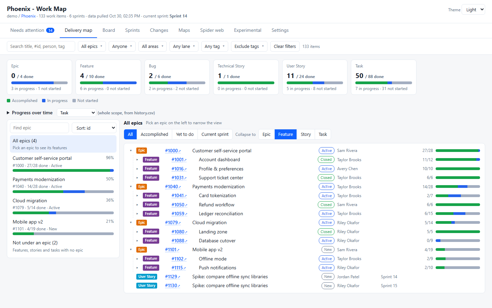

<sub>The live demo and all screenshots use the built-in demo data (<code>-Demo</code>), not a real project.</sub>

</div>

---

## Latest updates

### Preview &mdash; sprint planning live demo

A look at where ADO Work Map could go next: a **sprint planning** hub for Azure DevOps, run as a guided team meeting. **[Try it](https://dascondor.github.io/ado-work-map/sprint-planning.html)** &mdash; it's a demo on sample data that runs only in your browser. It isn't in the extensions yet.

- **Capacity check-in:** hours per day and time off per day &mdash; a full day, half a day or a few hours &mdash; plus team holidays, for sprints of 1 to 5 weeks. Each person's assigned work (task hours) is shown against their capacity.
- **Sprint calendar:** who's in each day, week by week, and a burn-up of capacity against planned work with an 80&ndash;100% target band.
- **Planning poker** with the full story &mdash; description, acceptance criteria, tasks and links &mdash; in a work item form, plus a team confidence vote to commit.
- **Fill the sprint** in people lanes or swimlanes (backlog &times; sprints), with one-click **Validation** and **Assisting team member** tasks.

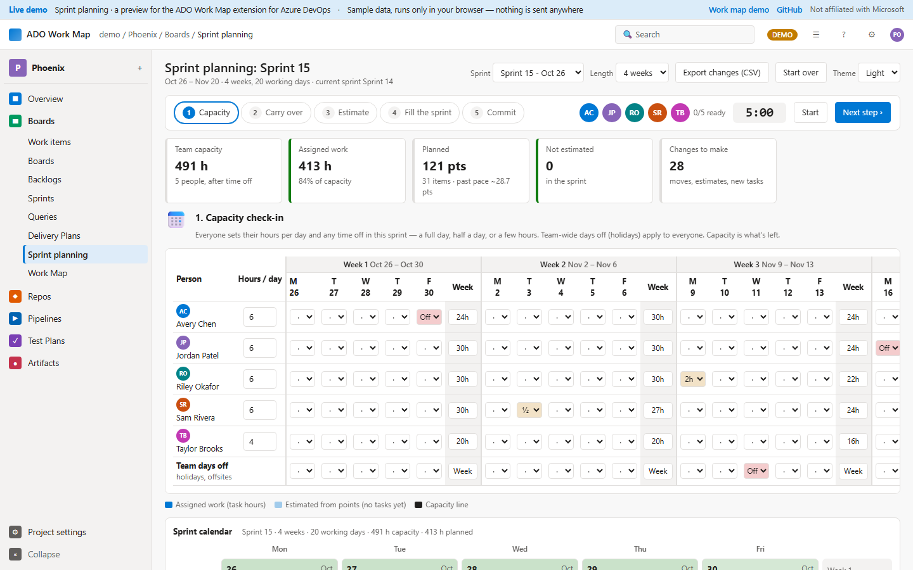

### 1.1.1 &mdash; heatmap tooltip fix

- **Fixed:** clicking a square low in the commit heatmap pinned a tooltip that was cut off by the bottom of the card. It now opens above the pointer when there's no room below, so every link stays visible.

Downloads: [release 1.1.1](https://github.com/DasCondor/ado-work-map/releases/tag/v1.1.1).

### 1.1.0 &mdash; maps by sprint, commit heatmap by person

- **Every map can show one sprint.** Pick a sprint above the treemap, repo matrix or commit heatmap (or click **Current sprint**). A banner shows which sprint, its dates and **Previous / Next** buttons.
- **Commit heatmap by person.** Switch between **Everyone** and **By person**:
  - **All sprints:** each person gets their own day-by-day calendar.
  - **One sprint:** one large square per day, with weekends shaded and days still to come dashed.
- **Tooltips on every square.** Hover for the date, the number of commits, and the people and repos involved. **Click** a square to pin it, with links to those commits in Azure DevOps.
- **One person, one row.** Commits under different names or accounts, such as `First Last` and `First.Last.CTR`, are counted as one person. Commit data now keeps the part of the email before the @ (never the full address) for this. Run a full refresh to add it to days pulled before this update.


Downloads: [release 1.1.0](https://github.com/DasCondor/ado-work-map/releases/tag/v1.1.0) (VS Code and Azure DevOps extensions). Full history: [releases](https://github.com/DasCondor/ado-work-map/releases) and the [VS Code extension changelog](vscode-extension/CHANGELOG.md).

## Why

- **Nothing to install.** Runs on the Windows PowerShell 5.1 that ships with Windows 10 and 11. No modules, no admin rights.
- **One file, fully offline.** The report is a single HTML file with everything inside it, the graph drawing included. No CDNs, no outside scripts.
- **Built for big projects.** Tested with 5,400 work items and 5,000 pull requests. Views open on a sensible slice and render lazily, so the page stays quick.
- **Only pulls what changed.** The first run pulls everything; every run after that asks Azure DevOps for just the changes since last time.
- **Light on the API.** Pull request info comes from the PR list endpoint, 1,000 per call, instead of one call per PR.
- **Read-only, no code.** It reads work items, PR metadata and commit dates. It never downloads file contents or diffs, and never writes anything to Azure DevOps.

## Contents

- [Latest updates](#latest-updates)
- [What's in the report](#whats-in-the-report)
- [Quick start](#quick-start)
- [VS Code extension](#vs-code-extension)
- [Azure DevOps extension](#azure-devops-extension)
- [Launch pad](#launch-pad)
- [How it works](#how-it-works)
- [Commands](#commands)
- [VS Code tasks](#vs-code-tasks)
- [Output files](#output-files)
- [Security and privacy](#security-and-privacy)
- [FAQ](#faq)

## What's in the report

A filter bar (search, epic, person, area, tag) sits above every tab and applies to all of them. Pick light, dark or auto in the header. Every `#1234` is a link straight to the work item in Azure DevOps.

### Delivery map

What's accomplished and what's left, from epic down to task. Pick an epic on the left to see its features on the right; use **Collapse to** Epic / Feature / Story / Task to choose how deep to look. Filter to *Accomplished*, *Yet to do* or *Current sprint*. A progress-over-time chart builds up from each run (or backfill it from Analytics with `-PullHistory`).

### Sprints

Every sprint on a timeline. Open one to see its numbers, **work by person** (click a name to filter the whole report to them) and its work as a collapsible Epic > Feature > Story > Task tree with remaining hours rolled up.

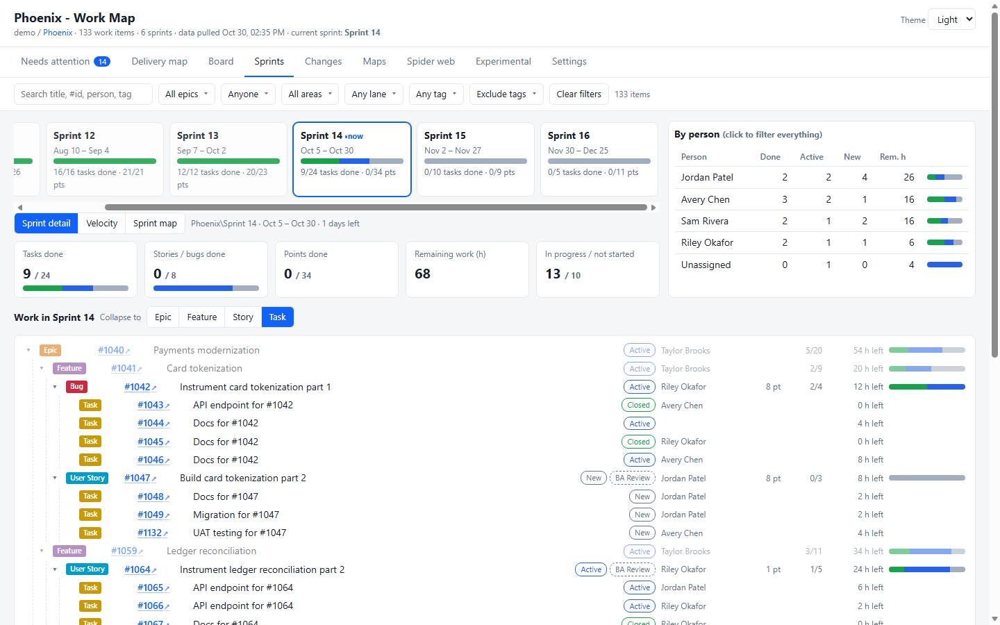

<table>
<tr>
<td width="50%">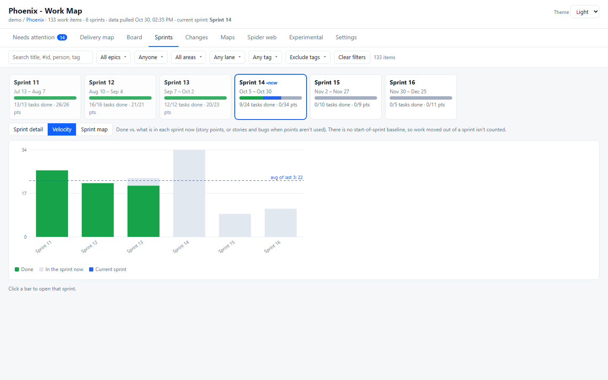<br><b>Velocity</b> &mdash; done vs planned per sprint, with the average of the last six.</td>
<td width="50%">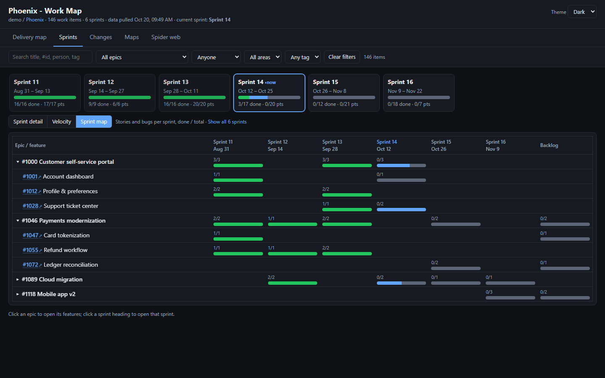<br><b>Sprint map</b> &mdash; epics and features against sprints, so you can see where work landed and what's coming.</td>
</tr>
</table>

### Changes

What changed in any time frame: the latest pull, the last 7 / 14 / 30 / 90 days, or custom dates. Created, completed and updated counts come straight from the work item dates. A change log recorded on every run adds the detail: state changes, sprint moves, reassignments, retitles, point changes, and items added to or dropped from scope.

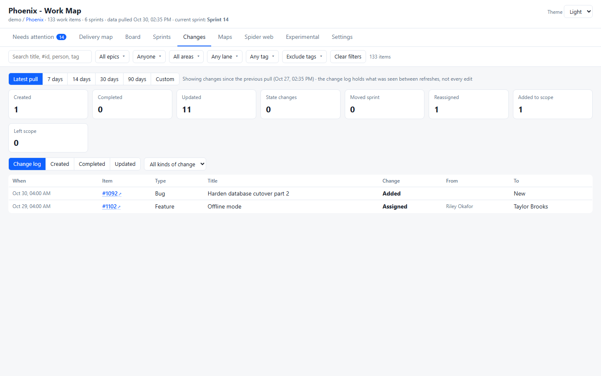

### Maps

Other ways to see the same data when a graph gets too busy. Pick a sprint above the maps (or **Current sprint**) and every map narrows to it, with a banner showing which sprint, its dates and Previous / Next buttons.

<table>
<tr>
<td width="50%">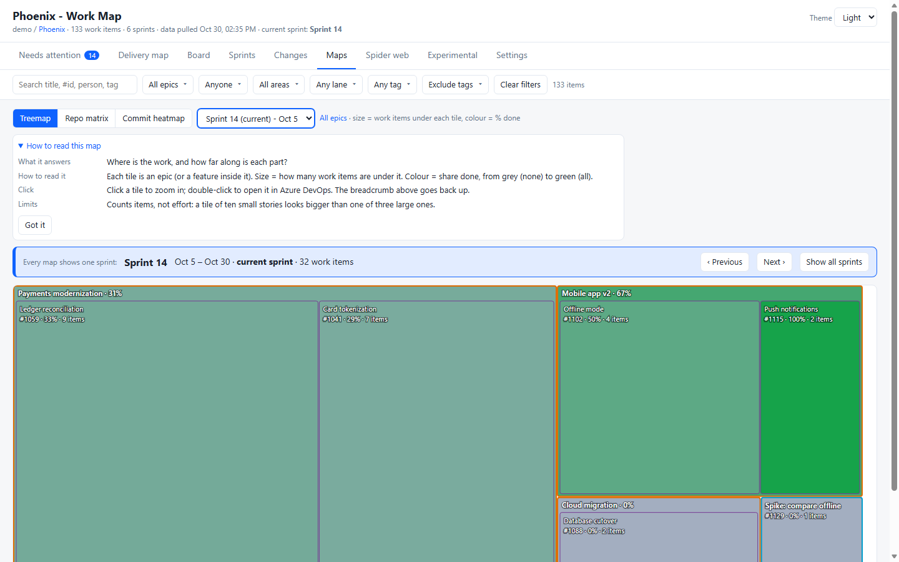<br><b>Treemap</b> &mdash; tile size is how much work, colour is % done. Click to zoom from epics to features to stories.</td>
<td width="50%">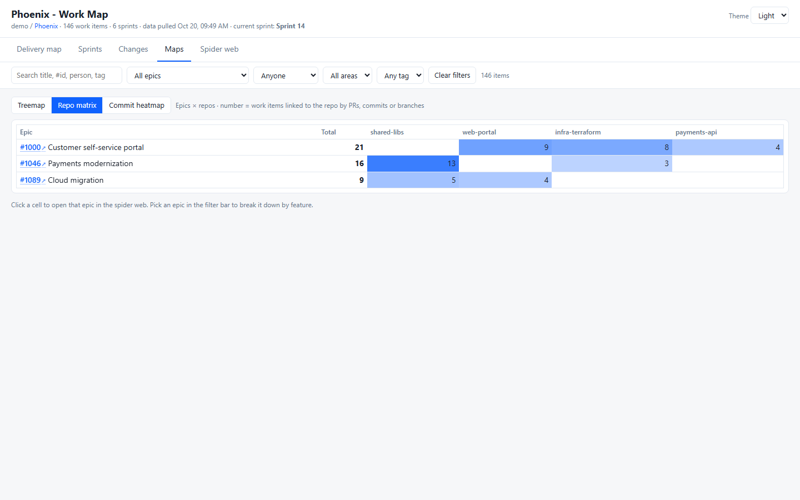<br><b>Repo matrix</b> &mdash; which epics (or features) touch which repos, through PRs, commits and branches.</td>
</tr>
</table>

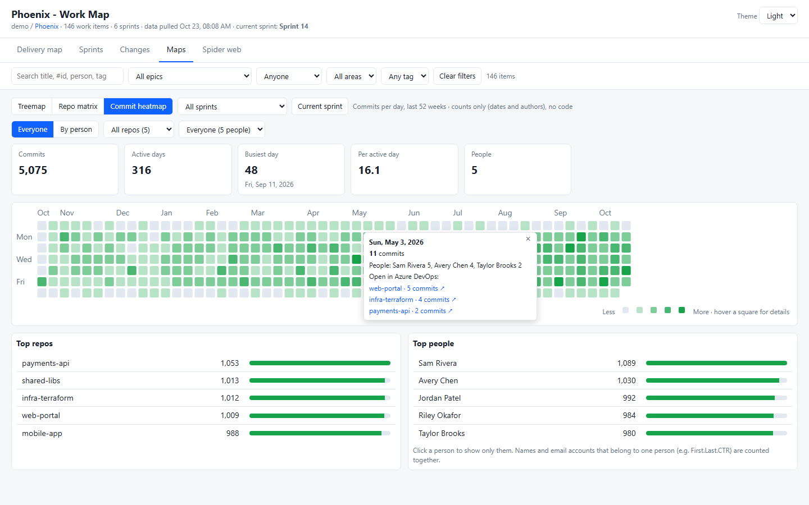

<table>
<tr>
<td width="50%">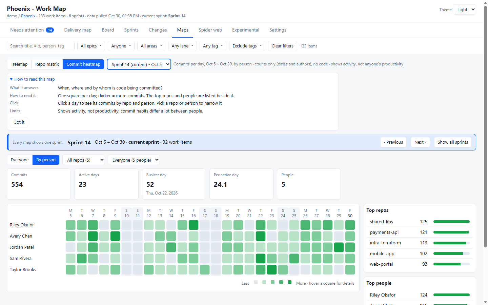<br><b>By person</b> &mdash; each person's own day-by-day calendar for the year, on one shared scale.</td>
<td width="50%"><br><b>One sprint</b> &mdash; a square per day for each person, weekends shaded, days still to come dashed.</td>
</tr>
</table>

**Commit heatmap** &mdash; commits per day for the last year, or day by day for one sprint. View **Everyone** in one grid or **By person** with a row each, filter by repo or person, and hover any square for the date, count, people and repos. Click a square to pin it, with links to those commits in Azure DevOps. One person's commits under different names or accounts (e.g. `First Last` and `First.Last.CTR`) are counted together. Only commit dates, author names and the part of the email before the @ are read.

### Spider web

The connections: work items, their parent/child, related and dependency links, and the PRs, branches, commits, builds and repos attached to them. It opens on the current sprint; switch to an overview, focus on one item's tree (double-click it), or pick any sprint. Large views ask before drawing, so the page never locks up.

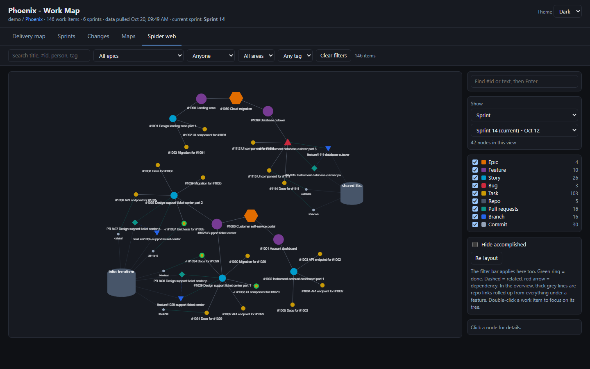

## Quick start

### Requirements

- Windows 10 or 11 (Windows PowerShell 5.1, already installed)
- An Azure DevOps personal access token with **read** access to: Work Items, Code, Project and Team, Build, and Analytics (Analytics is only needed for `-PullHistory`)
- A browser. The report is one self-contained HTML file with no outside libraries, so it works offline and can be emailed or shared as a single file.

### Steps

1. Download this repo (**Code > Download ZIP**) and unzip it anywhere.
2. Copy `run_ado_work_map.example.cmd` to **`run_ado_work_map.cmd`**. That name is git-ignored, so your token never ends up in a commit.
   In VS Code, the **ADO Map: Set up folders and starter** task does this for you (or run `ado_work_map.ps1 -Setup`).
3. Open it in Notepad and fill in:
   ```bat
   set "ADO_ORG=your-org"
   set "ADO_PROJECT=Your Project"
   set "ADO_PAT_VALUE=<your token>"
   ```
   Optional settings (team, epics, area path, history days and more) are documented right there in the file.
4. Double-click **`run_ado_work_map.cmd`**. The report opens from `ado_report\ado_work_map.html`.

Want a look first? No Azure DevOps needed:

```bat
run_ado_work_map.cmd -Demo
```

> [!TIP]
> Rather not keep a token in a file? Leave `ADO_PAT_VALUE` empty. The script then uses an `ADO_PAT` environment variable, an `az login` session, or asks you for the token.

## VS Code extension

Everything above, inside VS Code: the **ADO Work Map** extension bundles the script and gives it a launch pad in the sidebar, Command Palette commands, VS Code settings, a status bar item showing your last pull, and the report in an editor tab. Your token is kept in VS Code's secret storage (Windows Credential Manager) instead of a file.

**Install from the Marketplace:** search for **ADO Work Map** in the Extensions view, or run:

```bat
code --install-extension DasCondor.ado-work-map
```

**Or from GitHub:** download the `.vsix` from the [latest release](https://github.com/DasCondor/ado-work-map/releases/latest), then in VS Code open the Extensions view, click **...** > **Install from VSIX...** and pick the file. Updates install the same way.

Then click the **ADO Work Map** icon in the Activity Bar and follow the checklist. To build the `.vsix` yourself (no Node.js needed): `powershell -ExecutionPolicy Bypass -File vscode-extension\build.ps1`.

## Azure DevOps extension

The same report as a **Work Map** hub in **Boards**, inside Azure DevOps itself: no script, no token, nothing to run.

- **Your own access.** It reads with the signed-in person's permissions, so everyone sees only what they can already see.
- **Only pulls what changed.** The first visit pulls everything. The data is kept in that person's browser (IndexedDB), so later visits only ask for the changes, and the change log builds up between visits.
- **Settings in the hub:** team (for sprints), area path, work item types, epic ids, closed-within days, commit heatmap days. **Pull history** fills the progress chart from Analytics.
- **Read-only.** Scopes: Work items, Code, Project and team, Analytics (all read). Like the script, it reads PR metadata and commit dates, never file contents or diffs. There's no server behind it: nothing leaves Azure DevOps and the browser.

Azure DevOps Services only (not Azure DevOps Server). The hub is generated from the report template inside `ado_work_map.ps1`, so the two always match.

**Install:** the extension is published privately and shared with organizations on request. An organization admin then installs it from **Organization settings > Extensions > Shared**. To publish it under your own publisher instead, change `publisher` in `azure-devops-extension/vss-extension.json`, build it, and upload the `.vsix` at [marketplace.visualstudio.com/manage](https://marketplace.visualstudio.com/manage).

**Build:** `powershell -ExecutionPolicy Bypass -File azure-devops-extension\build.ps1` writes `dist\` and packages the `.vsix` with Microsoft's [tfx-cli](https://www.npmjs.com/package/tfx-cli) (`npm install -g tfx-cli`). The `.vsix` is also attached to each [release](https://github.com/DasCondor/ado-work-map/releases).

## Launch pad

Prefer buttons to commands? The launch pad is a small page for getting started and looking after your data. Start it with the **ADO Map: Launch pad** task in VS Code, or:

```bat
run_ado_work_map.cmd -Serve
```

It opens in your browser and walks you through setup (settings, folders, first pull, open the report), then gives you one-click **Pull changes**, **Full refresh**, **Rebuild report**, **Pull history**, **Clear archived data** and **Clear all data**, with a live log of each run and when your data was last pulled.

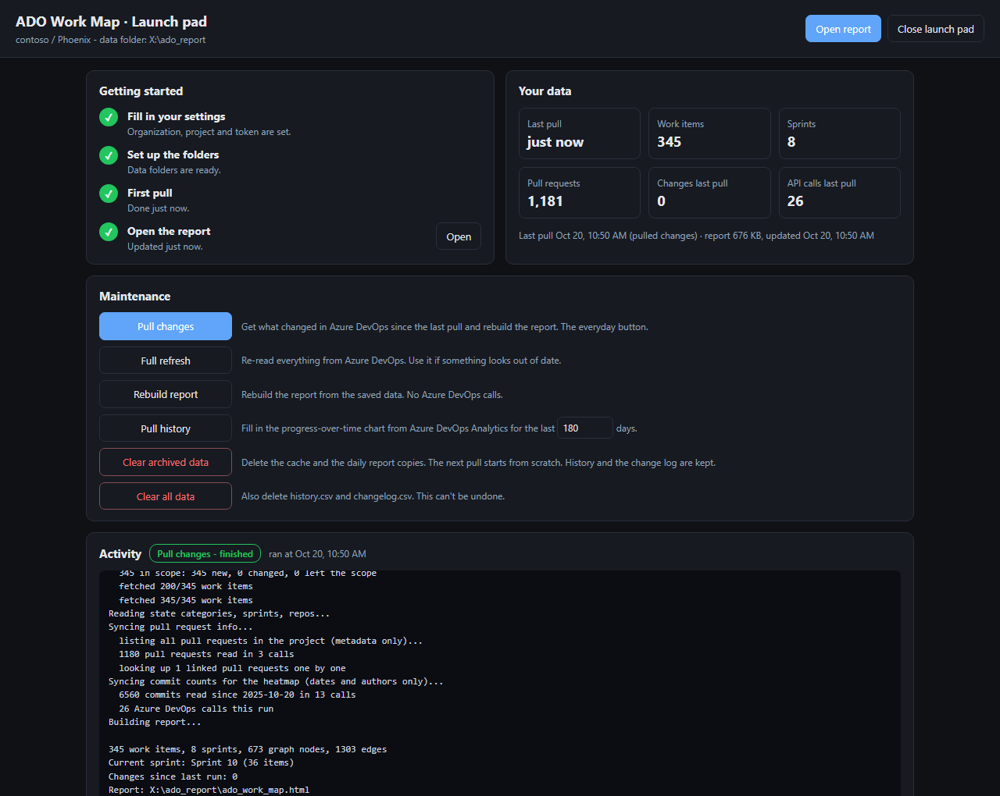

It's served by the script itself, only to this PC (`localhost`), and only to the link it prints, which carries a one-time key. Your settings and token stay in `run_ado_work_map.cmd`. Close it with **Close launch pad** or by stopping the task.

## How it works

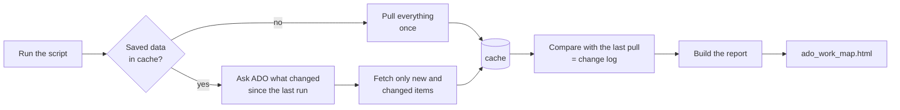

| Data | First run | Every run after |
|---|---|---|
| Work items | One id query, then details 200 per call | One "changed since" query, details only for what changed |
| Pull requests | Project PR list, 1,000 per call (metadata only) | Active PRs plus those closed since the last run |
| Commits (heatmap) | Dates, author names and the part of the email before the @, for the last `-CommitDays` days | Only the last two days are re-read |
| Sprints, repos, state names | One call each | One call each |

With 5,400 work items and 5,000 PRs on a local test server, a first run took about 40 calls and a typical later run about 13, plus a few calls per repository for the commit heatmap.

## Commands

Extra arguments go straight to the script, so these work after `run_ado_work_map.cmd` or with `ado_work_map.ps1` directly.

| Command | What it does |
|---|---|
| *(none)* | Pull changes since the last run and rebuild the report |
| `-Full` | Re-pull everything, ignoring the cache |
| `-Offline` | Rebuild the report from saved data, no Azure DevOps calls |
| `-PullHistory [-HistoryDays 180]` | Backfill `history.csv` from Azure DevOps Analytics, then run |
| `-ClearArchive` | Delete the cache and archived reports |
| `-ClearArchive -IncludeHistory` | ...and `history.csv` and `changelog.csv` too |
| `-Serve [-Port 8765]` | Open the [launch pad](#launch-pad) in your browser |
| `-Setup` | First-time setup: folders, the starter file, and a check of what's left to fill in |
| `-NoOpen` | Don't open the browser at the end |
| `-Demo` | Sample data, no connection |

<details>
<summary><b>All settings</b></summary>

| Parameter | Default | Meaning |
|---|---|---|
| `-Org`, `-Project` | | Your organization (the part after `dev.azure.com/`) and project |
| `-Team` | `<project> Team` | Team whose sprints are shown |
| `-Iteration` | team's current | Treat this iteration path as the current sprint |
| `-EpicId 1234,5678` | | Only these epics and everything under them |
| `-AreaPath` | | Only this area path and its children |
| `-Types` | Epic, Feature, User Story, Product Backlog Item, Requirement, Bug, Task | Work item types to include |
| `-ClosedWithinDays` | all | Skip items closed more than N days ago |
| `-IncludeRemoved` | off | Include items in the Removed state |
| `-CommitDays` | 365 | Days of commit history for the heatmap, `0` to turn it off |
| `-MaxPrDetails` | 500 | Cap on one-by-one lookups for linked PRs the list doesn't cover |
| `-ArchiveDays` | 30 | Days to keep the daily report copies, `0` to turn off |
| `-OutDir` | `.\ado_report` | Where everything is written |
| `-ServerUrl` | `https://dev.azure.com` | For Azure DevOps Server, see below |
| `-SaveConfig` | | Save the settings to `ado_work_map.config.json` (never the token) |

Run `Get-Help .\ado_work_map.ps1 -Full` for the full help.

</details>

### Azure DevOps Server (on-premises)

```bat
run_ado_work_map.cmd -ServerUrl https://tfs.contoso.com/tfs -Org DefaultCollection
```

Use the collection name as the organization.

## VS Code tasks

Open the folder in VS Code and choose **Terminal > Run Task...** (`Ctrl+Shift+B` runs the default):

| Task | |
|---|---|
| ADO Map: Set up folders and starter | First time: creates `ado_report\` (with `cache\` and `archive\`), creates `run_ado_work_map.cmd` from the example, checks it's git-ignored, lists the settings still to fill in and opens the file |
| ADO Map: Launch pad | Opens the [launch pad](#launch-pad) for setup and data maintenance |
| ADO Map: Run | Pull changes, open the report |
| ADO Map: Update data | Pull changes, don't open the browser |
| ADO Map: Full refresh | Re-pull everything |
| ADO Map: Rebuild report from saved data | No Azure DevOps calls |
| ADO Map: Pull history from ADO Analytics | Asks how many days |
| ADO Map: Clear archived data | Cache and archived reports |
| ADO Map: Clear ALL data | Also history and the change log |
| ADO Map: Demo report | Sample data |

The tasks call `run_ado_work_map.cmd`, so your settings live in one place.

## Output files

Everything is written to `ado_report\` next to the script.

| File | |
|---|---|
| `ado_work_map.html` | The report: one self-contained file that works offline. Open a tab directly with a link like `ado_work_map.html#/sprints` (add `:dark` or `:light` for a theme). |
| `ado_work_items.csv` | Flat list of work items for Excel |
| `ado_work_map.json` | All the report's data |
| `history.csv` | Daily counts per work item type, for the progress chart |
| `changelog.csv` | Changes detected between runs |
| `cache\` | Work items, PR info, commit counts and settings from the last pull |
| `archive\` | One copy of the report per day |

## Security and privacy

- **Read-only.** The script only reads from Azure DevOps; it never creates, edits or deletes anything there.
- **No code.** It reads work items, PR metadata (title, status, branches, author) and commit dates and authors (name and the part of the email before the @, used only to join one person's accounts). It never downloads file contents or diffs, and it doesn't save commit messages or PR descriptions.
- **Your token stays local.** The starter passes it through the environment, not the command line, so it doesn't show in the process list. It's never written to the config file, the cache or the report.
- **The output is your data.** The report and cache contain real work item titles and names. Keep `ado_report\` wherever your organization says that kind of data belongs.

## FAQ

<details>
<summary><b>Windows says the script is blocked</b></summary>

The starter already runs it with `-ExecutionPolicy Bypass`. To run the `.ps1` yourself:

```bat
powershell -ExecutionPolicy Bypass -File .\ado_work_map.ps1
```

</details>

<details>
<summary><b>The Sprints tab is empty</b></summary>

The script reads sprints from the team `<project> Team`. If your team has a different name, set `ADO_TEAM` (or `-Team`). The team needs sprints selected in its settings.

</details>


<details>
<summary><b>The history pull fails</b></summary>

`-PullHistory` uses Azure DevOps Analytics. It must be enabled for the project, and the token needs the **Analytics (Read)** scope.

</details>

<details>
<summary><b>I changed the epics / area / types and the first run took longer</b></summary>

The cache belongs to one scope. When the scope changes, the next run pulls everything once, then goes back to pulling only changes.

</details>

## License

[MIT](LICENSE)
