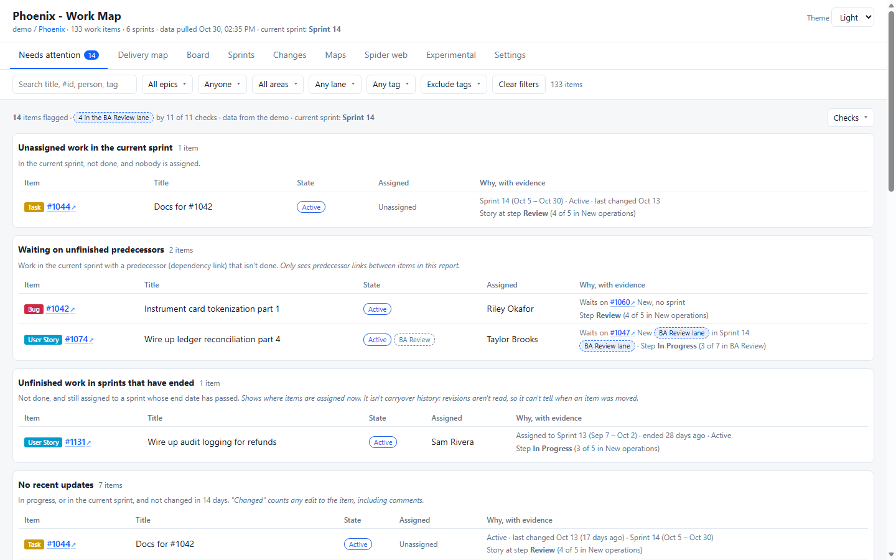

# Updates

Every release of ADO Work Map (PowerShell script and VS Code extension), newest first. Back to the [README](README.md).

### 1.6.1 &mdash; preview: swim lanes in every check

- **Needs attention:** every finding notes the swim lane (e.g. **BA Review lane**) and the step of its status flow; a task shows its story's lane and step.
- **Waiting on unfinished predecessors:** a predecessor in a swim lane is tagged with it too.
- **Summary line:** counts the flagged items in each lane (e.g. "4 in the BA Review lane").

### 1.6.0 &mdash; preview: status flows, swim lanes, settings

- **Settings tab** in the Work Map:
  - **Status flows:** the steps your stories go through (e.g. New > Ready > In Progress > Review > Resolved), by area path, iteration and/or swim lane. A step matches the board column, or else the state.
  - **Planning data the maps use:** turn Swim lane, Start Date and End Date on or off, and pick the date fields.
  - **UAT and stuck work:** the UAT swim lane (default BA Review), the UAT task title, and how many days in one step counts as stuck.
  - Saved for the whole project in the Azure DevOps extension, by VS Code for its reports, or exported as `ado_work_map.settings.json` next to the script.
- **Swim lanes:** each story's board lane and column are read; a **Lane** filter joins the filter bar and the lane shows beside the state.
- **Needs attention:** four new checks: stuck in one step of its flow, skipped a step, past its end date, and in the UAT lane without a UAT task.
- **Experimental maps:** Work aging follows your flow order, Dependencies flags a predecessor that ends after the waiting item starts, and Sprint flow counts moves to the UAT lane.
- **The first refresh after updating re-reads every work item once** (to read lanes, columns and dates).

### 1.5.2 &mdash; preview: experimental maps

- **Experimental tab** with eight new maps, each with a short **How to read this map** box you can fold away once you know it:
  - **Feature readiness:** each open feature checked for estimates, acceptance criteria, an owner, blockers and a sprint.
  - **People load:** remaining task hours per person per sprint, with an Unassigned row.
  - **Dependencies:** predecessor links laid over the sprints, with out-of-order plans in red.
  - **Work aging:** how long each item in progress has been going, against how long finished work took.
  - **Forecast:** likely finish dates (50% / 85% / 95%) from the team's real weekly pace.
  - **Sprint flow:** what each sprint started with, what was added, finished, carried over or moved out (from the change log).
  - **PR flow:** time to merge and waiting pull requests per repo.
  - **Cross-team:** which area paths wait on which, and how many of those hand-offs are late.
- **Safer report:** if one map or view can't be drawn, it says so in its place and the rest of the report keeps working. The experimental maps load separately, so a problem in them can't stop the report.
- **How to read this map** boxes on the treemap, repo matrix, commit heatmap and sprint map too.
- **Reads two more fields:** each work item's Activated Date and pull request open and close dates. The first refresh after updating re-reads every work item once.
- **Fixed:** the Changes tab's info line showed a garbled character instead of a dot.

### 1.5.1 &mdash; preview: frozen sprint headers, Checks menu

- **Sprint map:** the row with the sprint names stays in view while you scroll down through epics and features (the table's own styling was cancelling its frozen header).
- **Sprints:** the sprint cards stick flush under the filter bar, whatever its height, with no gap for content to show through.
- **Needs attention:** the **Checks** menu opens leftward from its button, so it no longer runs off the right edge of the page; its text wraps.

### 1.5.0 &mdash; preview

- **Needs attention** (new first tab): unassigned work in the current sprint, work waiting on unfinished predecessors, unfinished work still in sprints that have ended, items with no recent updates, stories without an estimate or acceptance criteria, and stories without a parent. Each finding shows why, with dates and a link; each check says what it can't see, can be turned off, and follows the filter bar. The estimate check is **Auto** (runs when at least half the stories in sprints have points or effort, and says so when it skips) or **Always**.
- **Between sprints** (e.g. the weekend before the next one starts) the next sprint is used and labelled **upcoming sprint** (with its start date), instead of there being none. Before, the report could fail to open in that gap.
- **Clearer numbers:** velocity compares done with what's in each sprint *now* (there's no start-of-sprint baseline, and it says so); the sprint strip says whether it counts tasks or items; the change log says it holds what was seen between refreshes, not every edit; data more than two days old is marked; the commit heatmap says it shows activity, not productivity.
- Acceptance criteria: only whether the field has text is read, never the text. The first refresh after updating re-reads every work item once to pick it up.
- **Check connection:** `run_ado_work_map.cmd -Check` (or **Check connection** in the launch pad, or **ADO Work Map: Check Connection** in VS Code) tests the token, project, team, sprints and permissions, reads only, and says in plain words what to change. If the team name is wrong, it lists your teams.
- Errors from Azure DevOps now say what they mean (token rejected, missing permission, not found) before the technical detail.
- Tests: `tests\Test-Report.ps1` and `tests\Test-Check.ps1` (headless Edge, fake Azure DevOps, no real connection).

### 1.4.6 &mdash; Commit heatmap uses the whole page

- **Commit heatmap fills the page:** the heatmap scales to the full width of its column (up to twice its normal size), with Top repos and Top people in a narrower column beside it.
- **By person, all sprints:** on wide screens the calendars sit side by side, so a team takes a few rows instead of one long column.
- Resizing the window redraws the maps for the new width.
- VS Code extension 1.4.6 bundles this script; the Azure DevOps extension is 1.4.6 too, from [ado-work-map-extension](https://github.com/DasCondor/ado-work-map-extension).

### 1.4.5 &mdash; A spread-out, readable spider web

- **Spider web, spread out:** more room between items and a margin around every label, so nothing overlaps. Each story keeps its tasks close, while repos and related links pull only gently, so groups stay apart instead of forming one knot.
- On big views zoomed out to fit, tasks, PRs, branches and commits show as dots; their names appear as you zoom in. Epics, features, stories and repos always keep their names.
- **Fixed:** in the Azure DevOps hub (and the demo frame) the layout started before the canvas had its size, so it stayed a circle in the middle. It now fills the canvas both ways.
- VS Code extension 1.4.5 bundles this script; the Azure DevOps extension is 1.4.5 too, from [ado-work-map-extension](https://github.com/DasCondor/ado-work-map-extension).

### 1.4.4 &mdash; Spider web uses the whole canvas

- **Spider web:** the layout spreads to the shape of the canvas instead of settling into a circle in the middle, so on a wide screen the graph uses the full width and labels overlap far less. Small graphs, like one sprint, are widened once the layout finishes (skipped if you've moved or zoomed).
- VS Code extension 1.4.4 bundles this script; the Azure DevOps extension is 1.4.4 too, from [ado-work-map-extension](https://github.com/DasCondor/ado-work-map-extension).

### 1.4.3 &mdash; Less empty space on Sprints and the commit heatmap

- **Sprint detail:** By person sits beside the sprint strip and totals, filling the empty space at the top; the sprint's work runs full width below. On narrow screens it drops back under the totals.
- **Commit heatmap:** Top repos and Top people sit in a column beside the heatmap (below it when the heatmap is too wide).
- VS Code extension 1.4.3 bundles this script; the Azure DevOps extension is 1.4.3 too, from [ado-work-map-extension](https://github.com/DasCondor/ado-work-map-extension).

### 1.4.2 &mdash; Layout fixes, sprint map expand / collapse all

- **Commit heatmap:** Top repos and Top people sit right under the totals, above the heatmap, instead of below it.
- **Sprint detail:** By person spans the full width above the sprint's work, so there's no empty column beside the tree.
- **Sprint map:** **Expand all** and **Collapse all** open or close every epic's features at once.
- **Live demo:** clicking **Boards** in the side panel folds its pages, or opens them as a menu when the panel is collapsed, so you can switch hubs either way.
- VS Code extension 1.4.2 bundles this script; the Azure DevOps extension is 1.4.2 too, from [ado-work-map-extension](https://github.com/DasCondor/ado-work-map-extension).

### 1.4.1 &mdash; Filters that narrow each other, Technical Stories, sprint map links

- **Filter bar:** people and tags are multiple choice, there's a persistent **Exclude tags** list (it survives Clear filters), and the area path can be saved as your default (**Open with this area path** inside the Area list). Every list only offers what the other filters leave: pick an area path and the Epic list shrinks to that area's epics. Lists longer than 5 get a search box.
- **Sprints:** the sprint strip stays put while you scroll a sprint's work. In the sprint map, epics and features are links, and hovering a cell lists its stories, technical stories and bugs with a link to each.
- **Technical Story** is a story type everywhere (delivery map, sprints, changes, maps) and its own kind in the spider web. If you pass your own `-Types`, add it there.
- The report uses the full window width, and the demo runs on 4-week sprints (Sprint 15 is Oct 26 &ndash; Nov 20), matching the Azure DevOps extension's demo.
- VS Code extension 1.4.1 bundles this script. The Azure DevOps extension with the same changes (and the new Sprint planning hub) is released from [ado-work-map-extension](https://github.com/DasCondor/ado-work-map-extension) as 1.4.1 too.

### Preview &mdash; sprint planning live demo

A look at where ADO Work Map could go next: a **sprint planning** hub for Azure DevOps, run as a guided team meeting. **[Try it](https://dascondor.github.io/ado-work-map/sprint-planning.html)** &mdash; it's a demo on sample data that runs only in your browser. It isn't in the extensions yet.

- **Capacity check-in:** hours per day and time off per day &mdash; a full day, half a day or a few hours &mdash; plus team holidays, for sprints of 1 to 5 weeks. Each person's assigned work (task hours) is shown against their capacity.
- **Sprint calendar:** who's in each day, week by week, and a burn-up of capacity against planned work with an 80&ndash;100% target band.
- **Planning poker** with the full story &mdash; description, acceptance criteria, tasks and links &mdash; in a work item form, plus a team confidence vote to commit.
- **Fill the sprint** in people lanes or swimlanes (backlog &times; sprints), with one-click **Validation** and **Assisting team member** tasks.

The [live demo](https://dascondor.github.io/ado-work-map/) now opens as it would look installed: the Work Map and Sprint planning as hubs under **Boards** in an Azure DevOps-style frame, with a collapsible side panel and Azure DevOps colours. Switching between the two hubs happens in place, and each keeps its place.

### 1.1.1 &mdash; heatmap tooltip fix

- **Fixed:** clicking a square low in the commit heatmap pinned a tooltip that was cut off by the bottom of the card. It now opens above the pointer when there's no room below, so every link stays visible.

Downloads: [release 1.1.1](https://github.com/DasCondor/ado-work-map/releases/tag/v1.1.1).

### 1.1.0 &mdash; maps by sprint, commit heatmap by person

- **Every map can show one sprint.** Pick a sprint above the treemap, repo matrix or commit heatmap (or click **Current sprint**). A banner shows which sprint, its dates and **Previous / Next** buttons.
- **Commit heatmap by person.** Switch between **Everyone** and **By person**:
  - **All sprints:** each person gets their own day-by-day calendar.
  - **One sprint:** one large square per day, with weekends shaded and days still to come dashed.
- **Tooltips on every square.** Hover for the date, the number of commits, and the people and repos involved. **Click** a square to pin it, with links to those commits in Azure DevOps.
- **One person, one row.** Commits under different names or accounts, such as `First Last` and `First.Last.CTR`, are counted as one person. Commit data now keeps the part of the email before the @ (never the full address) for this. Run a full refresh to add it to days pulled before this update.

Downloads: [release 1.1.0](https://github.com/DasCondor/ado-work-map/releases/tag/v1.1.0) (VS Code and Azure DevOps extensions). Full history: [releases](https://github.com/DasCondor/ado-work-map/releases) and the [VS Code extension changelog](vscode-extension/CHANGELOG.md).
