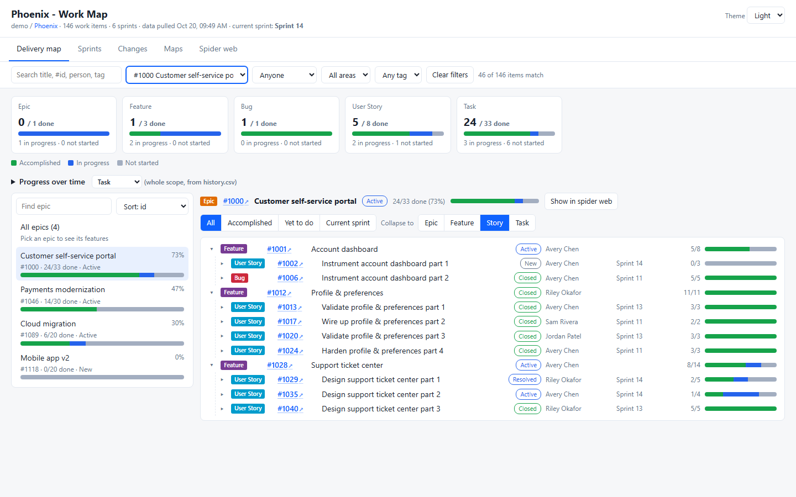
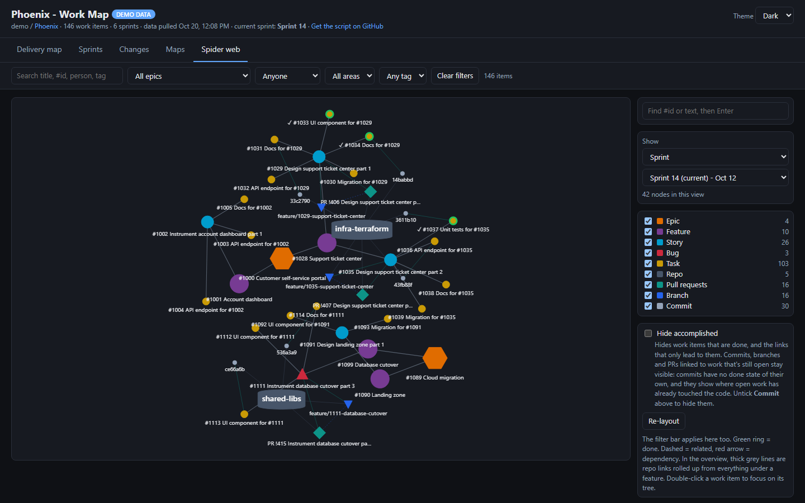
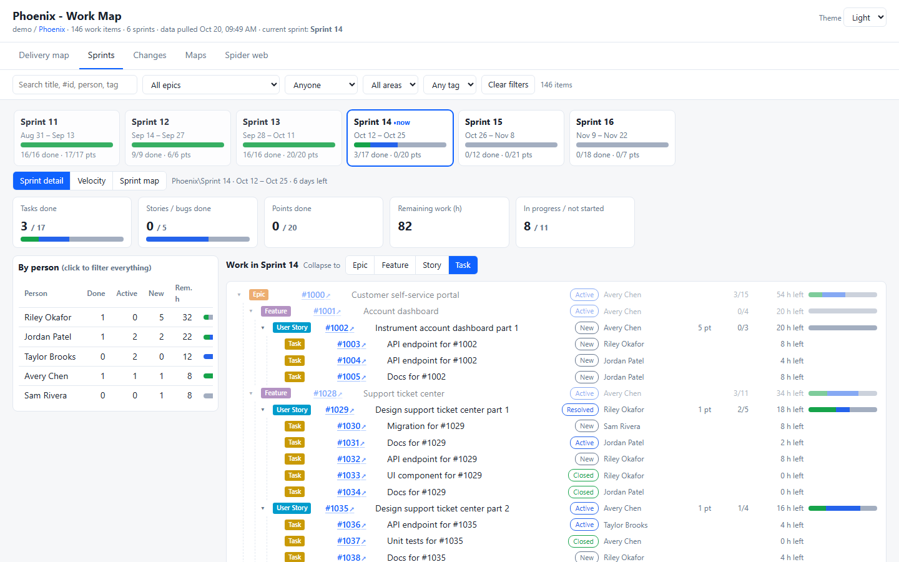

# ADO Work Map

A **Work Map** hub in **Boards** that shows a whole project at a glance - what's accomplished, what's left, what's in the current sprint, and how work items, pull requests, commits, branches and repos connect.

It's the same interactive report as the free [ADO Work Map PowerShell script](https://github.com/DasCondor/ado-work-map), built into Azure DevOps: no PAT, no script, no setup.

## What's in it

- **Delivery map** - Epic > Feature > Story > Task with accomplished / in progress / not started roll-ups, an epic list for big projects, collapse to any level, and progress over time.
- **Sprints** - every sprint on a timeline, the detail of any sprint, velocity, and a features x sprints map.
- **Changes** - what was created, completed, updated or moved in any time frame, plus a change log recorded between your visits.
- **Maps** - a treemap of epics and features by % done, a repo matrix, and a commit heatmap per day, repo and author.
- **Spider web** - work items and their links (parent/child, related, dependencies) plus the PRs, commits, branches, builds and repos attached to them. Starts on the current sprint; overview and focus modes keep big projects responsive.

Filters (search, epic, person, area, tag), light / dark theme, and links straight to every work item.

## How it works

- Open **Boards > Work Map** in any project.
- It reads with **your own access**: you only see what you can already see in Azure DevOps.
- The first visit pulls everything; after that only what changed since your last visit is pulled, so it opens quickly.
- Data is kept **in your browser** (IndexedDB) for this project. Nothing is sent anywhere except to Azure DevOps itself - there's no server behind this extension.
- **Settings** in the hub: team (for sprints), area path, work item types, epic ids, closed-within days, commit heatmap days.
- **Pull history** fills the progress-over-time chart from Azure DevOps Analytics.

## Permissions

| Scope | Used for |
|---|---|
| Work items (read) | Work items, states, sprints |
| Code (read) | Repos, pull request titles / status / branches, commit dates and authors - never file contents or diffs |
| Project and team (read) | The team list in Settings |
| Analytics (read) | Only when you click **Pull history** |

The extension never writes to Azure DevOps.

## Source

MIT licensed: [github.com/DasCondor/ado-work-map](https://github.com/DasCondor/ado-work-map). Issues and ideas welcome there.
